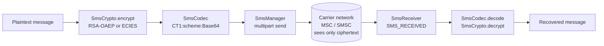
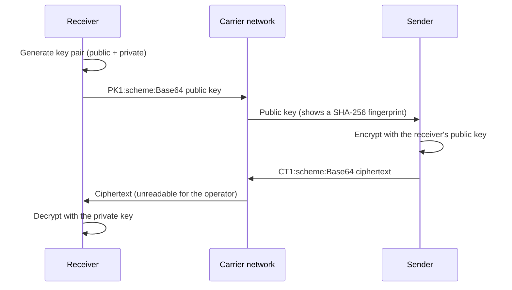
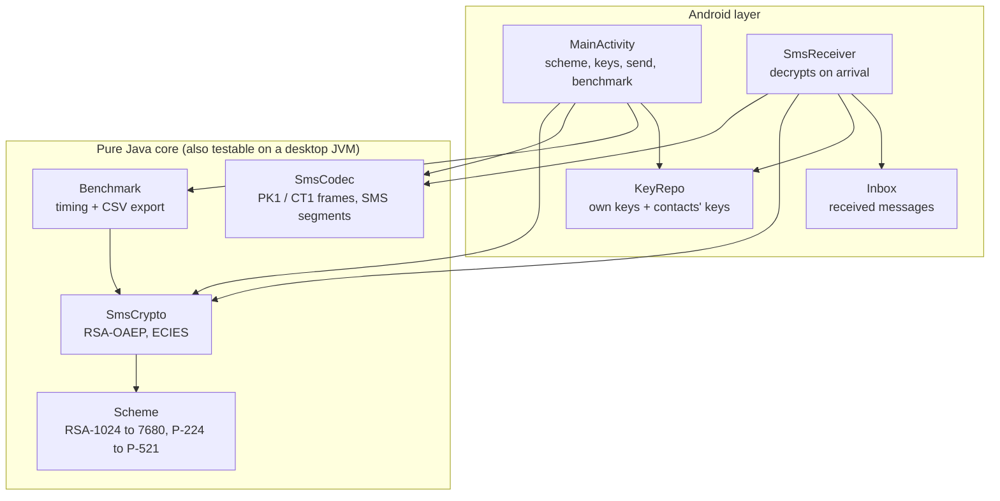
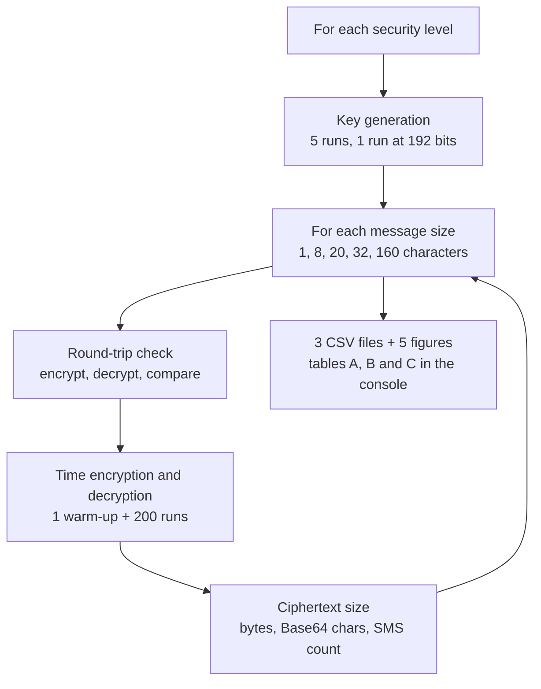
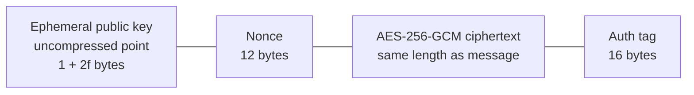

[README.md](https://github.com/user-attachments/files/35385509/README.md)
# Secure SMS with RSA and ECC


The repository contains two independent implementations that compare RSA and Elliptic Curve Cryptography (ECC) for protecting SMS messages:

| File | What it is | Language |
|---|---|---|
| `SecureSMS.zip` | Android app that encrypts real SMS with RSA or ECC and benchmarks both on the phone | Java (Android) |
| `RSA-ECC-time-comparison.zip` | Desktop benchmark harness and live demo that compare RSA and ECC at equal NIST security levels | Python |

Both use the same design: **RSA-OAEP (SHA-256)** for RSA, and **ECIES** (ephemeral ECDH + key derivation + AES-GCM) for ECC, because ECC cannot encrypt a message directly.

**Authors:** Carlos Lomelín Valdés, Rafael Corro Campos, Rodrigo Daniel Carretero Santamaria

---

## 1. SecureSMS (Android app)

An SMS travels through the operator's network in clear text. SecureSMS encrypts the message on the phone before it leaves, so the operator and any interceptor only see Base64 ciphertext.

### How a message travels



### Key exchange and encryption

The receiver shares its **public** key, the sender encrypts with it, and only the receiver's **private** key can decrypt.



### Code structure



### Features

- **Schemes:**
  - RSA-1024, 2048, 3072, 4096 and 7680, with OAEP-SHA-256. Long messages are split into fixed-size blocks.
  - ECC P-224, P-256, P-384 and P-521, with ECIES: ECDH, the ANSI X9.63 KDF over SHA-256, and AES-256-GCM.
- **Point compression:** the ephemeral point is compressed on P-256, P-384 and P-521 to save SMS space. On P-224 it is sent uncompressed.
- **Key exchange over SMS** itself, with a fingerprint to check that the key was not replaced.
- **Live estimate** of how many SMS segments a message will take.
- **In-app benchmark:** 10 warm-up rounds and 50 timed rounds per configuration, with messages of 16, 64 and 140 characters. Results can be shared as a CSV file.
- **No third-party crypto library:** everything comes from the Android platform provider (Conscrypt / BoringSSL).

### Build and run

1. Unzip `SecureSMS.zip` and open the `SecureSMS` folder in **Android Studio**.
2. Connect an Android phone (Android 8.0 / API 26 or newer) with USB debugging enabled, and press **Run**.
3. Grant the SMS permissions.
4. In the app:
   - choose a scheme, then tap **Generate key pair**;
   - type the contact's number and tap **Send my public key by SMS**;
   - once the contact's key arrives, type a message and tap **Encrypt & send**.

With only one phone, send everything to your own number. The phone then acts as both sender and receiver.

---

## 2. RSA vs ECC time comparison (Python)

A desktop benchmark that repeats the comparison under OpenSSL, pairing each RSA key with the curve of equal strength according to NIST SP 800-57.

| Security level | RSA | ECC |
|---|---|---|
| 80 bits | RSA-1024 | P-192 (stands in for the 160-bit curve) |
| 112 bits | RSA-2048 | P-224 |
| 128 bits | RSA-3072 | P-256 |
| 192 bits | RSA-7680 | P-384 |

### Benchmark flow



### ECIES ciphertext layout



### Files

| File | Purpose |
|---|---|
| `ecc_rsa_benchmark.py` | Full benchmark, writes CSV files and figures |
| `demo_ecc_sms.py` | Step-by-step demo with one readable SMS (used in the video) |

### Requirements

```bash
pip install cryptography matplotlib pandas
```

Tested with Python 3.11.9, `cryptography` 46.0.1 and OpenSSL 3.5.3.

### Usage

```bash
# quick run (RSA 1024, 2048, 3072)
python ecc_rsa_benchmark.py --runs 200 --keygen-runs 5

# full run used in the report (adds RSA-7680, takes several minutes)
python ecc_rsa_benchmark.py --sizes 1024 2048 3072 7680 --runs 200 --keygen-runs 5 --out results_full

# live demo, press ENTER between steps
python demo_ecc_sms.py --step
```

The demo generates both key pairs and encrypts one SMS with each scheme. It shows the Base64 ciphertext and how many SMS it needs, decrypts it, and runs a tamper test: flipping one byte makes both schemes reject the message.

---

## Main results

| | Android phone | Desktop |
|---|---|---|
| Encryption | RSA faster at every level | RSA faster at every level |
| Decryption at 128 bits | P-256 16.5x faster than RSA-3072 | P-256 21x faster than RSA-3072 |
| Decryption at 192 bits | P-384 87x faster than RSA-7680 | P-384 40x faster than RSA-7680 |
| Key generation | ECC thousands of times faster | ECC thousands of times faster |
| SMS needed at 128 bits | 2 vs 4 (64-character message) | 3 vs 4 (160-character message) |

Decryption happens at the receiver, and from 112 bits onward ECC decrypts faster and sends fewer SMS on both platforms. **ECC is the better fit for securing SMS on mobile devices.**

## References

1. H. Bodur and R. Kara, "Secure SMS Encryption Using RSA Encryption Algorithm on Android Message Application," ISITES, 2015.
2. M. Agoyi and D. Seral, "SMS Security: An Asymmetric Encryption Approach," ICWMC, IEEE, 2010.
3. E. Jintcharadze and M. Abashidze, "Performance and Comparative Analysis of Elliptic Curve Cryptography and RSA," EWDTS, IEEE, 2023.
4. NIST SP 800-57 Part 1 Rev. 5, *Recommendation for Key Management*, 2020.
